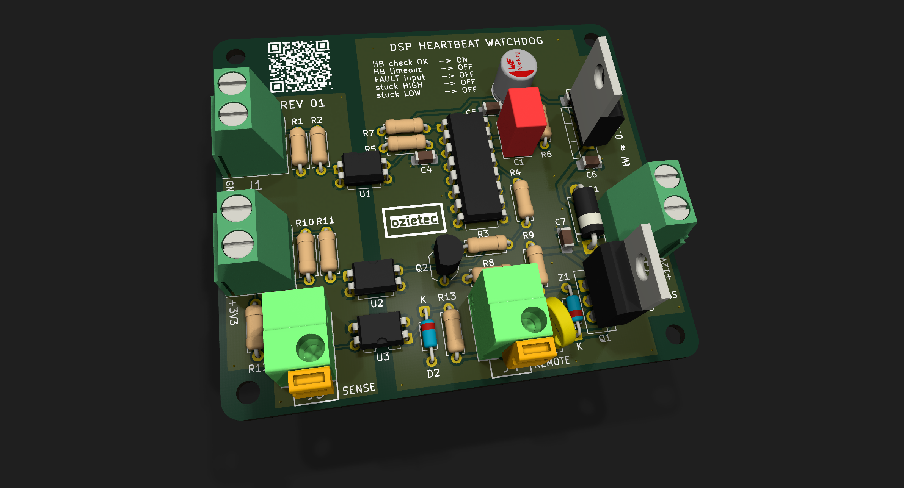
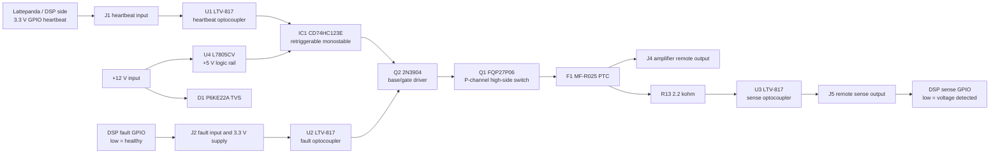

# DSP Heartbeat Watchdog Board

## Purpose

This experimental board switches the 12 V amplifier remote output in a car PC
audio system. A 3.3 V heartbeat from the DSP keeps a hardware timer armed, a
separate fault input can disable the output, and an isolated sense line reports
the voltage state back to the DSP.

## Before You Build or Connect

Use an upstream fuse on the 12 V input. F1 is a resettable PTC that limits
current on the remote output. Review the behavior below and bench-test the
board before connecting an amplifier. See the [Bring-Up Checklist](#bring-up-checklist)
and [Known Limitations](#known-limitations).

### Connector Summary

| Connector | Pin or terminal | Net | Function |
|---|---|---|---|
| J1 | Pin 1 | `DSP_HB_3V3` | 3.3 V heartbeat from the DSP |
| J1 | Pin 2 | `DSP_GND` | Shared DSP-side return for heartbeat, fault, and sense |
| J2 | Pin 1 | `DSP_FAULT_IN` | Fault GPIO, driven low when healthy |
| J2 | Pin 2 | `DSP_3V3` | 3.3 V supply for the fault and sense pullups |
| J3 | Pin 1 | `+12V` | Fused 12 V input |
| J3 | Pin 2 | `CAR_GND` | Car or bench supply ground |
| J4 | Single wire entry | `AMP_REM` | Switched amplifier remote output |
| J5 | Single wire entry | `REMOTE_SENSE` | Active-low voltage feedback to the DSP |

J1 pin 2 is the board's only connector for `DSP_GND`. J4 and J5 each use a
Phoenix 1790490 terminal with one wire entry and two PCB solder tails on the
same net. The amplifier remote input uses the amplifier's own ground return.

### Enable and Shutdown Behavior

| Condition | Heartbeat timer | Fault clamp |
|---|---|---|
| Heartbeat edges arrive within the timeout and the fault GPIO is low | Keeps the output driver enabled | Inactive |
| Pulses stop or J1 pin 1 opens while J1 pin 2 stays connected | Switches J4 off when the timer expires | Remains available with DSP supply and ground intact |
| Fault GPIO goes high or Hi-Z, or its signal wire opens, with `DSP_3V3` and `DSP_GND` intact | Continues to follow heartbeat edges | U2 clamps the driver and switches J4 off |
| Control process crashes or exits, or the DSP reboots | Times out if heartbeat edges stop | Depends on the GPIO state. A pin still driving low leaves the clamp inactive |
| **J1 ground return opens**, including when both J1 wires are disconnected | Times out after the last trigger | Loss of `DSP_GND` can release an active clamp and briefly turn J4 on while the timer is still armed |
| **Complete J2 disconnection**, with on-board R12 as the only pullup on J5 | Can keep J4 on as long as heartbeat edges continue | U2 loses its input drive and any active clamp releases |
| Board unpowered or `+5V` absent | Timer inactive. R9 defaults Q1 off | — |
| Heartbeat held high at power-on, fault clamp inactive | Reset release can trigger one output pulse. See [Hardware Timeout](#hardware-timeout) | Inactive |

With J2 disconnected and U3 off, an additional pullup on J5, including the
DSP GPIO's internal pullup, can feed the U2 LED through R12, R10, and R11.
Whether that current can hold the fault clamp active depends on the pullup
strength.

## Project Status and Publication Scope

The author designed and hand-assembled REV 01 for a private installation and
shares the design free of charge. No boards, kits, or services are offered. The
design is licensed under `CERN-OHL-S-2.0`, which allows commercial use under its
terms. See [License](#license) and [Validation Status and Scope](#validation-status-and-scope).

## Project Files

- [KiCad project](dhw.kicad_pro), [schematic](dhw.kicad_sch), and [PCB layout](dhw.kicad_pcb)
- [Bill of materials](dhw.csv) with part numbers and datasheet links where available
- [Project footprints](libs/Watchdog.pretty/) for the Bourns MF-R025 and Phoenix Contact 1790490
- [Hand-built SPICE testbenches](spice/testbenches/) and [auto-generated runs](spice_runs/)

Open the project in KiCad 10 with the standard symbol and footprint libraries
installed. All schematic symbols use the standard libraries. The
[footprint library table](fp-lib-table) resolves the two local footprints
through `${KIPRJMOD}`. Those footprints reference optional STEP models under
`libs/3D_models/` that are absent from this checkout.

The companion watchdog software is maintained separately. See
[Timing Notes](#timing-notes) for the heartbeat settings used for this design

## High-Level Architecture

## Functional Description

### Heartbeat Input Path

R2 (680 Ω) limits the U1 optocoupler LED current. R1 (100 kΩ) pulls the
heartbeat input low when the drive floats. When the DSP GPIO pulse goes
high, U1 pulls `HB_ISO_LOW` low on the car-ground side. R7 (47 kΩ) pulls
that node up to `+5V` between pulses. The falling edge triggers IC1.

### Hardware Timeout

IC1 is a CD74HC123E retriggerable monostable. The first monostable section is
used as the heartbeat watchdog timer.

The first section uses the following IC1 pins.

- pin 1, `~1A`: heartbeat trigger input, net `HB_ISO_LOW`
- pin 2, `1B`: tied to `+5V`
- pin 3, `~1R`: power-on reset network R5/C4 (see below)
- pin 13, `1Q`: watchdog output, net `MONO_Q`
- pin 14, `1CX`: timing capacitor node
- pin 15, `1RXCX`: timing resistor/capacitor node
- pin 16, `VCC`: `+5V`
- pin 8, `GND`: `CAR_GND`

The inputs and timing pins of the second section (`~2A`, `2B`, `~2R`, `2CX`,
and `2RXCX`) are tied to `CAR_GND`, holding it in reset. The unused outputs
(`~1Q`, `2Q`, and `~2Q`) carry no-connect flags.

R6 (220 kΩ) and C1 (1 µF, 63 V film, WIMA MKS2C041001F00JSSD) set the
nominal timeout. See [Timing Notes](#timing-notes) for the calculation and
other R6 values.

R5 (200 kΩ) and C4 (100 nF) hold `~1R` low at power-on while C4 charges. If
the heartbeat GPIO is already held high, U1 holds `~1A` low while `1B` is
high. The CD74HC123 can trigger as reset rises under those conditions. If
the fault clamp is inactive, J4 can energize for one timeout without a new
heartbeat edge. See the truth table in the
[TI CD74HC123 datasheet](https://www.ti.com/lit/ds/symlink/cd74hc123.pdf#page=2).

### Fault Input Path

The DSP is intended to drive `DSP_FAULT_IN` low only while healthy and
intentionally armed. When the GPIO floats or its signal wire opens, the
3.3 V supply feeds the U2 optocoupler LED through the R10 pullup (680 Ω) and
R11 (330 Ω). A GPIO driven high supplies current through R11 directly. With
a 1.2 V LED drop, these paths give about 2.1 mA and 6.4 mA respectively at
3.3 V.

U2 pulls `Q2_BASE` low and turns off the output driver even while the
monostable is active. Its input LED returns through `DSP_GND` on J1 pin 2.
See [Enable and Shutdown Behavior](#enable-and-shutdown-behavior) for the
effects of connector and GPIO faults.

### Remote Output Driver

The amplifier remote output is switched by Q1, a P-channel MOSFET used as a
high-side switch.

- Q1 FQP27P06
  - pad 1: gate, net `Q1_GATE`
  - pad 2: drain, net `Q1_DRAIN`
  - pad 3: source, net `+12V`
- Q2 2N3904 pulls the Q1 gate low when `MONO_Q` is high and U2 is inactive
  - pad 1: emitter, `CAR_GND`
  - pad 2: base, `Q2_BASE`
  - pad 3: collector, `Q2_COLL`
- R4: 47 kohm base feed from `MONO_Q` into Q2
- R3: 100 kohm base pulldown on `Q2_BASE`
- R9: 100 kohm gate pullup to `+12V`, defaulting Q1 off
- R8: 10 kohm between Q1 gate and Q2 collector
- Z1 BZX55C12-TAP clamps Q1 gate-source voltage
  - cathode to `+12V`
  - anode to `Q1_GATE`
- F1 MF-R025 PTC is in series with the remote output
  - F1 pin 1: `Q1_DRAIN`
  - F1 pin 2: `AMP_REM`

J4 exposes `AMP_REM` through its single wire entry. When Q2 is off, R9
returns the Q1 gate to the source rail and turns Q1 off.

### Remote Sense Feedback

R13 (2.2 kΩ) feeds the U3 optocoupler LED from `AMP_REM` after F1 (about
4.9 mA at 12 V). D2 (1N4148) clamps reverse voltage across the LED, with its
cathode at the R13/U3 node and its anode at `CAR_GND`.

J5's single wire entry carries `REMOTE_SENSE`. With `DSP_3V3` and `DSP_GND`
present, U3's open collector pulls J5 low when the post-F1 voltage is high
enough to drive the optocoupler. R12 (10 kΩ) pulls J5 high when U3 releases
it. Software can flag a mismatch between the commanded state and this
voltage indication. A tripped F1 is one possible cause of low output voltage.
The board itself takes no action based on the sense line.

Treat sense as unavailable if the DSP supply or ground is lost. With J2
unplugged and U3 off, R12 has no supply to drive J5 high, so the reading can
float or follow the receiving GPIO's bias.

## Power Architecture

- D1 (P6KE22A) clamps transients on the 12 V input. Pad 1 is the cathode on
  `+12V` and pad 2 is the anode on `CAR_GND`.
- U4 (L7805CV) generates the local `+5V` logic rail. Pins 1 through 3 are
  `+12V`, `CAR_GND`, and `+5V` respectively.
- C2 (10 µF, 63 V polymer hybrid, Würth 870575873001) provides bulk capacitance
  on `+5V`.
- C6 (470 nF, 50 V) bypasses the U4 input. C3 (100 nF) bypasses its output.
- C5 and C7 (100 nF each) bypass the IC1 supply and the 12 V switch stage,
  respectively. C4 (100 nF) belongs to the reset circuit.

C3–C7 are 1206 SMD ceramics. The other electrical components are through-hole.

## Timing Notes

The companion configuration uses 20 Hz (one trigger edge every 50 ms), a 5 ms
pulse width, and a 70 ms software jitter warning threshold. The hardware
needs one clean trigger edge per period. The software warning is a diagnostic
that depends on the process running.

At 5 V, the CD74HC123 nominal pulse width is approximately
`0.45 × R6 × C1`. With the installed 220 kΩ and 1 µF, the calculation gives
99 ms, leaving about 49 ms of nominal margin at 20 Hz. The back silkscreen
lists these R6 options for other heartbeat intervals (C1 remains 1 µF).

| Heartbeat | Period | Nominal margin with 220 kΩ | Silkscreen R6 options | Nominal timeout with those options |
|---:|---:|---:|---|---|
| 50 Hz | 20 ms | 79 ms | 91 / 130 kΩ | 41 / 59 ms |
| 25 Hz | 40 ms | 59 ms | 180 / 270 kΩ | 81 / 122 ms |
| 20 Hz | 50 ms | 49 ms | 220 / 330 kΩ | 99 / 149 ms |
| 15 Hz | 66.7 ms | 32 ms | 300 / 430 kΩ | 135 / 194 ms |
| 10 Hz | 100 ms | None | 470 / 680 kΩ | 212 / 306 ms |

Trigger gaps must stay below the actual timeout. Allow for R6/C1 tolerance,
temperature, supply variation, and scheduling jitter when selecting the
heartbeat rate and checking the assembled board.

## PCB / Fabrication Details

- Board size is 72.0 mm × 64.0 mm with two copper layers. Separate `CAR_GND`
  and `DSP_GND` pours appear on both sides.
- The layout has 31 through-hole components, five 1206 components, and four
  3.2 mm non-plated M3 mounting holes.
- The board routes 24 nets and uses 48 vias (0.60 mm diameter, 0.30 mm drill),
  mostly for ground stitching.
- The project specifies a 0.20 mm minimum track width, a 0.30 mm minimum
  through-hole drill, and a 0.15 mm minimum via annular ring.

Order bare boards for hand assembly. Typical settings are 2-layer FR-4,
1.6 mm thickness, 1 oz copper, ENIG or lead-free HASL, and electrical testing.

## Validation Status and Scope

### Saved Simulations

| Testbench | Scope and saved result |
|---|---|
| [Monostable RC model](spice/testbenches/tb_monostable_timeout.cir) | Uses the older 200 kΩ R6 and 1 µF C1. The simulated RC interval after the last discharge ends is about 90 ms. The 99 ms for the current 220 kΩ value is a nominal calculation. |
| [Gate driver](spice/testbenches/tb_gate_driver.cir) | With a generic MOSFET, an idealized Q2 switch, and a cold F1, the model gives about 10.9 V from source to gate when enabled at 12 V. |
| [Optocoupler LED drive](spice/testbenches/tb_opto_led_drive.cir) | A generic IR LED with a 680 Ω series resistor draws about 3.1 mA at 3.3 V. The model covers the U1 LED drive. It omits the U2 fault clamp and U3 sense path. |

See [Known Limitations](#known-limitations) for the hardware validation scope.

## Bring-Up Checklist

### Bench Checks

1. With the amplifier disconnected, inspect solder joints and verify diode
   and transistor orientation. D1's cathode goes to `+12V`. D2's cathode goes
   to the R13/U3 node. Q1 pads 1 through 3 are gate, drain, and source.
2. Connect the DSP supply and ground per the [connector table](#connector-summary).
   Hold the heartbeat and fault GPIOs low. Apply fused, current-limited 12 V
   to J3. Confirm U4 supplies about 5 V and J4 remains off.
3. Switch off the 12 V supply and let the board power down. Keep the fault
   GPIO low and hold the heartbeat GPIO high before reapplying 12 V. Observe
   J4 relative to `CAR_GND` on an oscilloscope and check for a brief enable
   pulse as reset releases. Return the heartbeat GPIO to low before continuing.
4. Apply the 20 Hz heartbeat and confirm J4 turns on and J5 goes low. Stop
   the pulses, measure the interval from the last trigger edge to J4 turning
   off, and confirm J5 returns high. Compare the measured interval with the
   99 ms nominal value.
5. With the heartbeat running and the DSP supply and ground connected, drive
   the fault GPIO high, then test it in Hi-Z. Confirm J4 turns off in both
   cases. Restore the healthy state between tests.
6. Test the wire-loss and full-disconnection cases in the
   [enable and shutdown table](#enable-and-shutdown-behavior). Restore the
   wiring between cases.

   - For J1 ground loss, reference the J4 scope probe to `CAR_GND` and
     verify that test equipment provides no alternate `DSP_GND` return.
     Run the heartbeat, assert the fault, and confirm J4 is off. With the
     timer still armed, use an inline switch to open J1 pin 2 while leaving
     pin 1 connected. Watch for a brief J4 pulse as the clamp releases.
   - For complete J2 disconnection, remove or disable any additional J5
     pullup to reproduce the table case. If the installation uses a pullup,
     repeat the test with that pullup in place.

7. Repeat with a representative dummy load and record the results before
   connecting an amplifier.

### Software Checks

- If using `camilladsp_watchdog.py`, confirm it logs `hb_gap_ms`, `hb_max_ms`,
  and `hb_missed`. Stress the Linux system and check that observed heartbeat
  gaps stay below the 70 ms warning threshold and the measured hardware timeout.
- Observe the real GPIO states during boot, shutdown, and process exit or
  failure. Verify task supervision stops the heartbeat or asserts the fault
  when the monitor task fails.
- Compare `REMOTE_SENSE` with the commanded output state and flag a mismatch
  while the DSP supply and ground are present. Treat the reading as unavailable
  when either connection is lost.

## Known Limitations

- The board has no automotive certification. The repository records no
  measurements of assembled hardware and no EMC, load-dump, reverse-polarity,
  jump-start, vibration, thermal-cycling, or lifetime tests.
- D1 is a transient clamp. Load-dump and reverse-polarity protection are
  outside the design scope.
- U1, U2, and U3 provide functional signal isolation between `DSP_GND` and
  `CAR_GND` in a 12 V system. The grounds may share a return elsewhere in the
  installation. Use the isolation only for low-voltage signals.
- Reserve the 5 V rail for on-board loads. To probe the board, use component
  leads and connector pins because there are no dedicated test points.

## Revision Notes

- PCB silkscreen identifies the board as `DSP HEARTBEAT WATCHDOG`, `REV 01`.
- Current schematic note says the heartbeat source is `+3.3V`, `20 Hz`,
  `Lattepanda Mu`.
- The board carries a front-silk truth table and timeout formula, a back-silk
  R6 tuning table per heartbeat rate, the Q1 pinout legend, connector function
  labels, ground-domain markings, and a QR code. The stuck-level entries on
  the truth table describe behavior after the timeout. See
  [Hardware Timeout](#hardware-timeout) for power-on behavior.

## License

This hardware design is licensed under the CERN Open Hardware Licence Version
2, Strongly Reciprocal (`CERN-OHL-S-2.0`). See the full text in
[`LICENSE`](LICENSE).